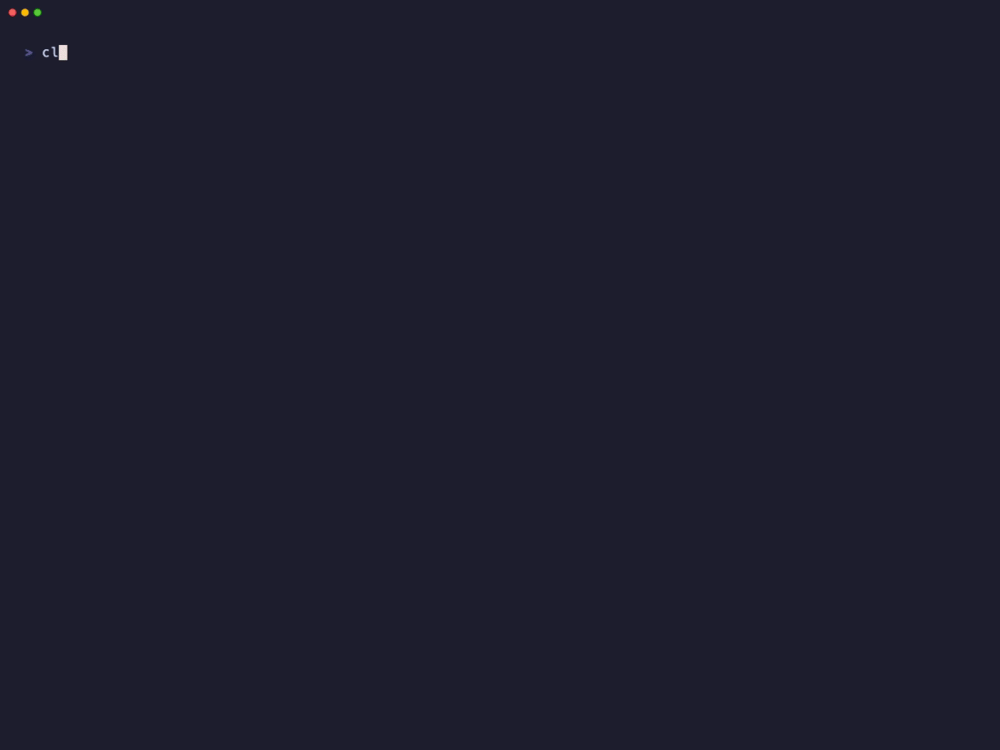
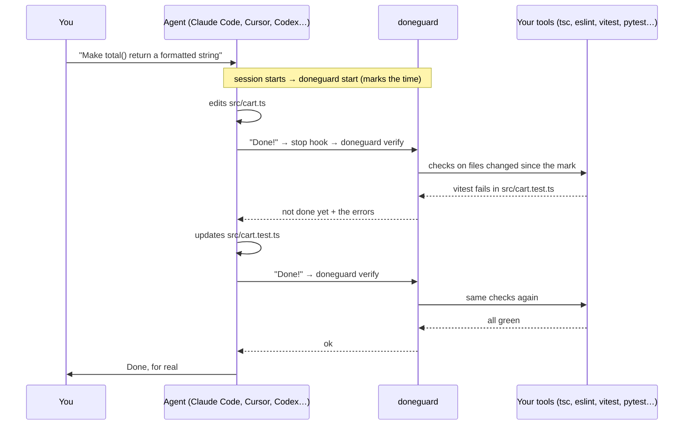
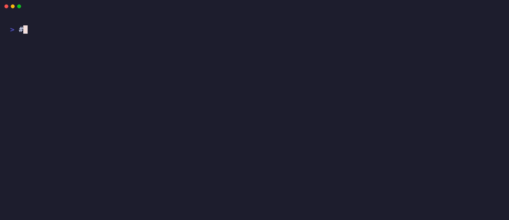
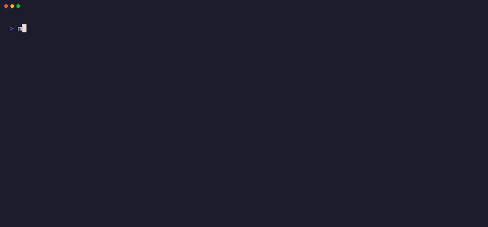
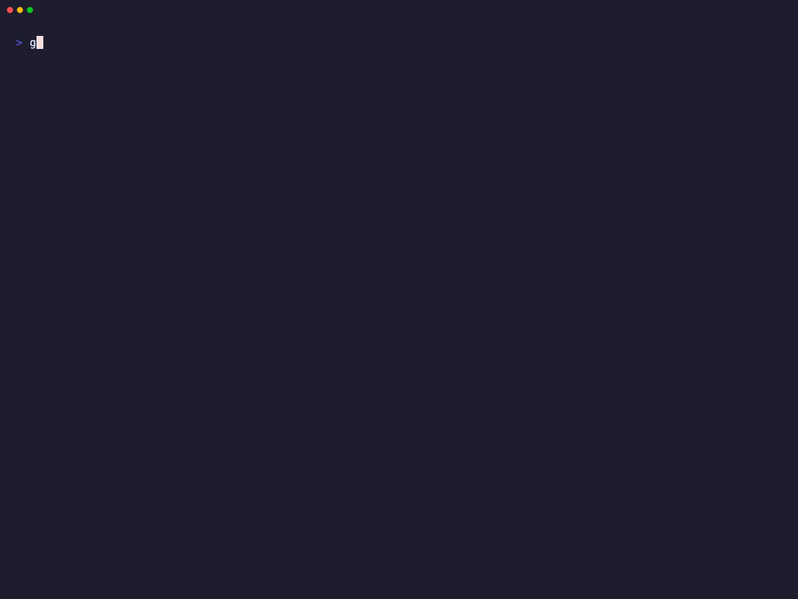

<div align="center">

# doneguard

**Your AI coding agent can't say "done" until the checks pass.**




<sub>A real Claude Code session. The agent can only read and edit files here, so it can't run the tests itself: doneguard does when it tries to stop.</sub>

</div>

Agents love to finish with *"Done! ✅"* while the types are broken and the tests are red. You find out ten minutes later.

doneguard is a **stop hook**. When the agent tries to finish, doneguard runs your type checker, linter and *related* tests on the files changed in the session. If anything fails, the errors go straight back to the agent and it keeps working until they pass.

- [Works with your agent](#works-with-your-agent)
- [How it works](#how-it-works)
- [Install](#install)
- [Add it to an existing project](#add-it-to-an-existing-project) · [Start from zero](#start-a-new-project-from-zero)
- [Without hooks: CI, git hooks, any agent](#without-hooks-ci-git-hooks-any-agent)
- [Stats](#stats) · [Day to day](#day-to-day) · [Teams](#teams)
- [Stacks](#what-init-detects) · [Configuration](#configuration) · [Commands](#commands) · [FAQ](#faq)

## Works with your agent

Not using Claude Code? doneguard speaks each agent's own hook format. `doneguard init` hooks into the agents it finds, or name them: `doneguard init cursor codex`.

| Agent | How doneguard keeps it working | Status |
|---|---|---|
| **Claude Code** | `Stop` hook → `decision: block` | ✅ tested end to end |
| **Cursor** (IDE and CLI) | `stop` hook → `followup_message` | 🧪 |
| **OpenAI Codex CLI** | `Stop` hook → `decision: block` | 🧪 |
| **Gemini CLI** | `AfterAgent` hook → `decision: block` | 🧪 |
| **GitHub Copilot** (CLI and VS Code) | `agentStop` hook → `decision: block` | 🧪 |
| **Google Antigravity** | `Stop` hook → `decision: continue` | 🧪 |
| **Devin Local** (successor of Windsurf Cascade) | `Stop` hook → `decision: block` | 🧪 |
| **Kiro CLI** | `Stop` hook → `decision: block` | 🧪 |
| **Aider** | `lint-cmd` → Aider's own fix loop | 🧪 |
| **OpenCode** | plugin on `session.idle` → new prompt | ⚗️ experimental |
| **Cline, Windsurf Cascade, anything else** | a rule: *"run `doneguard check` before saying done"* | manual |

✅ the GIF above. 🧪 built from the agent's official hook docs and tested against its documented payloads. ⚗️ experimental. If one misbehaves with your version, please open an issue.

Cursor, Copilot and Devin also run the hooks in `.claude/`. When Claude Code is hooked too, `init` doesn't add theirs, so nothing runs twice.

## How it works



1. **`doneguard init`** looks at your project, writes the checks to `.doneguard.conf` and registers two hooks in your agent's config.
2. **Session starts:** the agent runs `doneguard start`, which notes the time.
3. **The agent says it's done:** before letting it stop, the agent runs `doneguard verify`.
4. **verify** lists the files modified since the mark (respecting `.gitignore`), runs only the checks whose globs match them, and only the tests related to them.
5. **Something fails:** the errors go back to the agent in its own format and it keeps working. **Everything passes:** the agent stops and the mark moves forward.
6. **Safety valve:** after 3 failed attempts in a row, doneguard lets the agent stop and tells you, so it never loops forever.

## Install

```bash
uv tool install git+https://github.com/abranchesia/doneguard
# or: pipx install git+https://github.com/abranchesia/doneguard
doneguard --help
```

If your shell can't find `doneguard` afterwards, run `uv tool update-shell` (or `pipx ensurepath`) and open a new terminal. The hooks call `doneguard` by name, so it has to be on your `PATH`.

Requirements: Python 3.9+ (only to run doneguard itself), macOS or Linux, and the tools your checks call (`tsc`, `ruff`, `cargo`…) installed in the project. git is optional; with it, change detection respects `.gitignore`.

## Add it to an existing project



```bash
cd your-project
doneguard init              # detects the stack and your agents, writes .doneguard.conf, adds the hooks
doneguard check src/app.ts  # optional: dry-run the checks on any file
```

Then restart your agent so it loads the hooks, and:

1. **Read `.doneguard.conf`.** One line per check, plain text. Delete what you don't want, add what's missing ([format](#configuration)).
2. **Commit `.doneguard.conf`.** Your team and your CI share the same checks.
3. **Work as usual.** Old errors elsewhere in the repo don't matter: doneguard only looks at files changed in the session.

Using an agent that `init` didn't find (or several)? Name them: `doneguard init codex gemini`, or `doneguard init all`.

## Start a new project from zero

In an empty folder there's nothing to detect yet. Run `init` once to install the hooks, scaffold the project, then run `init` again: it fills in the checks as soon as it finds a stack.



```bash
mkdir my-app && cd my-app
doneguard init              # hooks installed, 0 checks for now
npm init -y && npm i -D typescript vitest && npx tsc --init
doneguard init              # now detects tsc + vitest
```

Letting the agent scaffold the project? Tell it: *"once the project is set up, run `doneguard init`"*. The config is read on every stop, so the checks kick in right away.

## Without hooks: CI, git hooks, any agent

`doneguard check` runs the same checks on your git changes (or on the files you pass) and exits 1 on failure. No agent needed.



**GitHub Actions**, on the files changed in the pull request:

```yaml
on: pull_request
jobs:
  doneguard:
    runs-on: ubuntu-latest
    steps:
      - uses: actions/checkout@v4
        with:
          fetch-depth: 0
      - run: npm ci                  # install your project's tools
      - run: pipx install git+https://github.com/abranchesia/doneguard
      - run: doneguard check $(git diff --name-only origin/${{ github.base_ref }}...HEAD)
```

**Git pre-commit hook:**

```bash
printf '#!/bin/sh\nexec doneguard check $(git diff --cached --name-only)\n' > .git/hooks/pre-commit
chmod +x .git/hooks/pre-commit
```

**Agents without a stop hook** (Cline, Windsurf Cascade…): add to `AGENTS.md` or the agent's rules: *"Before saying you're done, run `doneguard check` and fix everything it reports."*

## Stats

doneguard keeps a tiny local log of every checked stop. Ask it how many times it caught your agent:

```text
$ doneguard stats
doneguard stats since 2026-10-30
  stops checked        2 in 1 session(s)
  "done" blocked       1
  fixed by the agent   1 of 1 (100%)
  most failing         vitest (1)
  agents               claude (2)

Caught 1 broken "done" claim(s); the agents fixed 100% on their own.
```

That's the real output of the session in the GIF at the top. The log lives in `~/.local/state/doneguard/log.jsonl` (or `$XDG_STATE_HOME`) and stores only times, agent names, results and tool names: no code, no paths. Delete it to start over.

## Day to day

- **You don't run anything.** The hooks fire on their own when a session starts and every time the agent tries to stop.
- **When a check fails**, the agent gets the errors and keeps going. You see it fixing things instead of saying "done".
- **If it still fails after 3 tries**, the agent stops (Claude Code shows `doneguard: checks still failing after 3 fix attempts`).
- **Pause a check** by commenting its line with `#` in `.doneguard.conf`. It takes effect on the next stop.
- **Check by hand** at any time: `doneguard check`.

## Teams

Commit `.doneguard.conf`. Each developer installs doneguard and runs `doneguard init`, which keeps the existing config and adds their hooks.

Hook files that live in the repo (`.cursor/hooks.json`, `.codex/hooks.json`, `.gemini/settings.json`, `.github/hooks/doneguard.json`…) run for everyone who opens the project with that agent. Commit them only if everyone has doneguard installed: without it, their agent reports a failed hook on every stop. Claude Code's hooks go to `.claude/settings.local.json`, which is personal.

## What `init` detects

| Stack | Detected by | Check |
|---|---|---|
| TypeScript | `tsconfig.json` | `tsc --noEmit`, errors in changed files only |
| ESLint | `eslint` in `package.json` | `eslint --quiet` on changed files |
| Vitest / Jest | `vitest` or `jest` in `package.json` | `vitest related` / `jest --findRelatedTests` |
| Python | `pyproject.toml`, `setup.py`, `requirements.txt` | `ruff` (syntax errors, undefined names), `pytest` on related tests |
| Rust | `Cargo.toml` | `cargo check`, errors in changed files only |
| Go | `go.mod` | `go vet`, findings in changed files only |
| Java | `pom.xml` | `mvn compile`, errors in changed files only |
| PHP | `composer.json` | `php -l` on changed files |
| Swift | `Package.swift` | `swift build`, errors in changed files only |

It looks at the root and one folder down, so monorepos work: JS checks run once per package (`@package.json`). For Python it uses `uv run` or `.venv/bin/` when it finds them. Anything else is one line of [configuration](#configuration) away.

## Configuration

`.doneguard.conf` lives at the root of the project. One check per line, `#` for comments:

```text
# <globs>  | <dir>         | <mode>  | <command>
*.ts,*.tsx | @package.json | filter  | npx --no -- tsc --noEmit --pretty false -p .
*.py       | .             | files   | .venv/bin/ruff check --select E9,F63,F7,F82 --output-format concise
*.py       | .             | tests   | .venv/bin/pytest -x -q --tb=short {tests}
*.rb       | .             | files   | bundle exec rubocop --format emacs
*.sql      | .             | command | ./scripts/check-migrations.sh
```

| Field | Meaning |
|---|---|
| `globs` | Comma-separated, matched against the path relative to the root. `*` also crosses folders. |
| `dir` | Where the command runs, relative to the root. `@<file>` means the nearest folder holding `<file>`, so `@package.json` runs once per package in a monorepo. |
| `mode` | How the result is judged, see below. |
| `command` | Any shell command. Pipes are fine. |

| Mode | Runs | Fails when |
|---|---|---|
| `files` | `command <changed files>` | exit code is not 0 |
| `filter` | `command` as is | an output line cites a changed file (perfect for whole-project tools like `tsc`) |
| `tests` | `command` with `{tests}` replaced by the related tests (`test_x.py`, `x_test.go`, `x.test.ts`, `x.spec.ts`, `XTest.php`…) | exit code is not 0; skipped when there are no related tests |
| `command` | `command` as is | exit code is not 0 |

A tool that isn't installed or a check that takes longer than 150 s is skipped, never failed.

## Commands

| Command | What it does |
|---|---|
| `doneguard init [agents…]` | Detect the stack, write `.doneguard.conf` (if it has no checks yet) and add the hooks to the agents found here, or to the ones you name (`all` for every one). Safe to run again. |
| `doneguard check [files…]` | Run the checks on the given files, or on your git changes. Exit 1 on failure. |
| `doneguard stats` | How many "done" claims were blocked, and how many the agents fixed. |
| `doneguard start` | Hook: mark the start of a session (reads the event JSON on stdin). |
| `doneguard verify` | Hook: check the files changed since the mark and answer in the agent's format. |

## FAQ

**Do I need Claude Code?** No. See [Works with your agent](#works-with-your-agent). Without any agent, `doneguard check` works in CI and git hooks.

**Does it slow the agent down?** It runs once, when the agent tries to stop, and only the checks that match the changed files. Usually a few seconds.

**My project already has lint errors.** `filter` checks (tsc, cargo, go vet, mvn, swift) only count errors in changed files. `files` checks lint whole files, so the default ruff rules are fatal errors only: syntax errors and undefined names.

**The agent changed a function and broke a file it didn't touch. Will doneguard see it?** Related tests will: `vitest related` and `jest --findRelatedTests` follow imports. Type errors in untouched files are ignored on purpose, so old errors never block anyone.

**What if I edit files while the agent works?** Your changes count too: doneguard checks every file modified since the agent last finished, whoever changed it.

**Does it catch edits the agent makes through shell commands?** Yes. It compares modification times, so `sed`, codegen and scripts count, not just the edit tool.

**Does it send my code anywhere?** No. It runs your own tools on your machine. No network calls, no telemetry. It's one file: [`doneguard.py`](https://github.com/abranchesia/doneguard/blob/main/doneguard.py).

**How do I uninstall?** Remove the `doneguard` entries from your agent's hook config, delete `.doneguard.conf`, then `uv tool uninstall doneguard`.

**Windows?** macOS and Linux for now: commands run through `sh`.

## Contributing

Small on purpose: one file, standard library only. New stack detections, agent adapters and reports from agents marked 🧪 are welcome.

```bash
uvx pytest            # run the tests
vhs demo/check.tape   # re-record a GIF (needs vhs and npm; claude.tape also needs Claude Code)
```

## License

[MIT](https://github.com/abranchesia/doneguard/blob/main/LICENSE)
